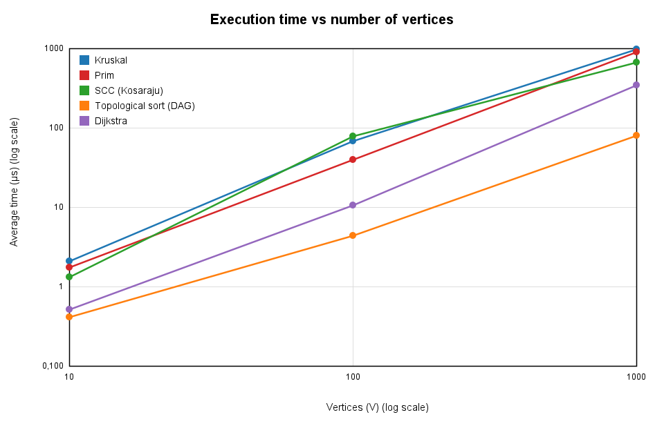
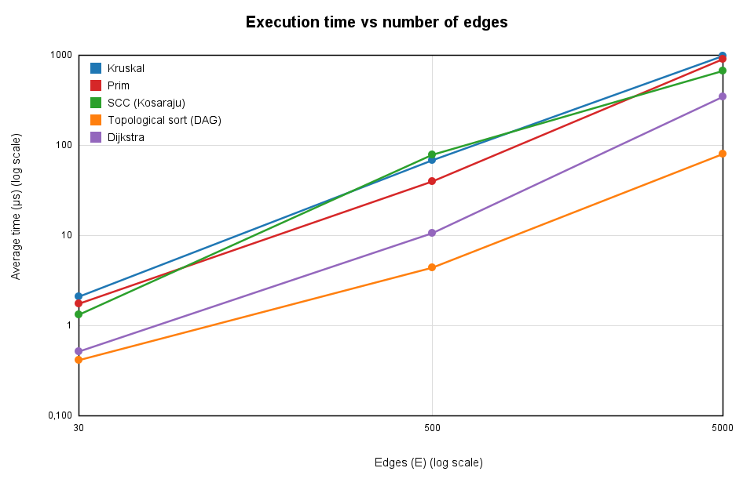
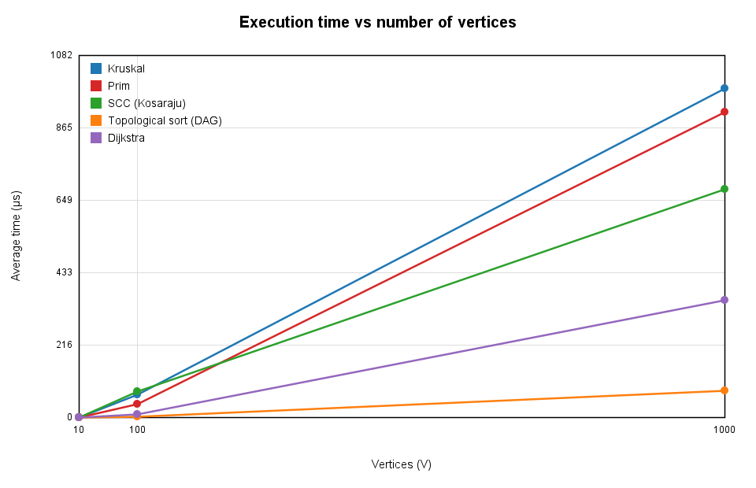
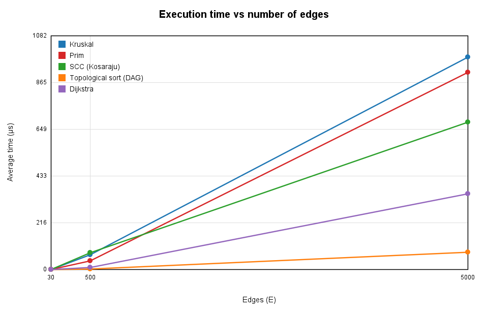
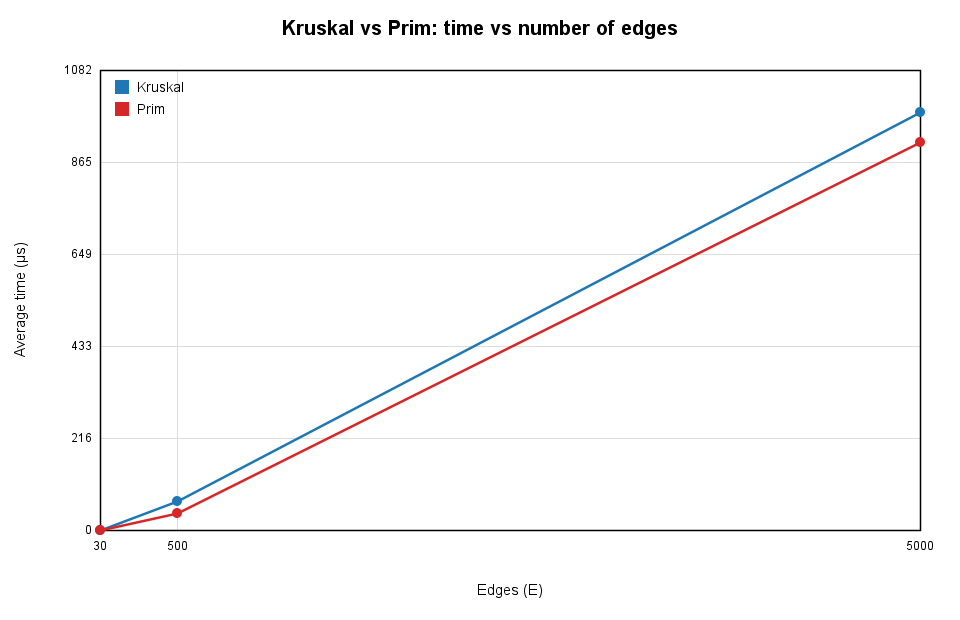

# Assignment 3 — Smart City Infrastructure and Route Planning

Java application that models a city as a graph and solves three planning problems:
**infrastructure planning** (Minimum Spanning Tree), **connectivity analysis** (topological order, strongly connected components) and **route planning** (shortest paths).
This README is the complete report: implementation notes, complexity analysis, experimental setup, results, discussion and testing.

> **Author:** _<Shyndaly Bagnur, SE2502>_ &nbsp;|&nbsp; **Java:** 17+ (tested on OpenJDK 21) &nbsp;|&nbsp; **Dependencies:** none

## Repository structure

```
assignment-3/
├── src/
│   ├── Main.java                  experiments: runs everything, writes tables and plots
│   ├── graph/                     Edge, Graph (adjacency list), GraphGenerator (seeded random graphs)
│   ├── dsu/                       DSU (path compression + union by rank)
│   ├── mst/                       Kruskal, Prim, MSTResult
│   ├── connectivity/              TopologicalSort (Kahn), SCC (Kosaraju)
│   ├── shortestpath/              Dijkstra, DijkstraResult
│   ├── util/                      Table (md/csv writer), ChartWriter (PNG line charts, Java2D)
│   └── tests/                     Tests (dependency-free test runner)
├── results/
│   ├── tables/                    all result tables (.md and .csv)
│   ├── plots/                     all plots (.png)
│   └── demo_output.txt            sample output of every algorithm on a small graph
└── README.md
```

### Build and run

```bash
# from the repository root
javac -d out $(find src -name "*.java")     # Linux / macOS / Git Bash
java -cp out tests.Tests                     # run all correctness tests
java -cp out Main                            # run experiments -> results/tables, results/plots
```

On Windows PowerShell: `javac -d out (Get-ChildItem -Recurse src -Filter *.java).FullName`.
All graphs are generated with a fixed seed, so operation counts are identical on every run; only the measured times vary slightly between machines.

---

## 1. Overview

A city is modelled as a weighted graph:

| Graph element | Meaning |
|---|---|
| Vertex (0..V-1) | district / location |
| Edge | road or infrastructure connection |
| Weight (int, 1..100) | construction cost (MST task) or travel distance (shortest-path task) |

* **Representation:** adjacency list (`List<List<Edge>>`) plus a flat list of logical edges. An undirected edge is stored once in `edges()` (needed by Kruskal) and twice in the adjacency lists (needed by Prim/DFS). A directed edge is stored once in both. An adjacency list is the right choice here because all test graphs are sparse (E = 3V … 5V) and every algorithm needs "all edges leaving *u*" in O(deg u).
* **Tasks:**
  1. MST — Kruskal (with DSU) and Prim (with a priority queue), total weight, connectivity detection.
  2. Connectivity — topological ordering of a DAG with cycle detection, SCCs.
  3. Shortest paths — Dijkstra from a source to all districts, with unreachable-vertex handling.

## 2. Implementation

**Graph / generators (`graph/`).** `GraphGenerator` has three seeded generators, all without self-loops and parallel edges:
`connectedUndirected` (random spanning tree first, then random extra edges ⇒ always connected), `directedAcyclic` (draw a random vertex order, every edge goes forward in that order ⇒ always a DAG), `randomDirected` (uniform random distinct ordered pairs ⇒ usually cyclic).

**DSU (`dsu/DSU.java`).** Arrays `parent[]` and `rank[]`. `find` is iterative (no recursion, no stack overflow on deep trees) and does **path compression** in a second pass; `union` does **union by rank**. The class also has flags to switch each optimisation off, so the benefit of each one can be measured (Tables 2–3), and counters for `find` calls, `union` calls and parent-pointer hops.

**Kruskal (`mst/Kruskal.java`).** Copy the edge list, sort by weight (comparisons counted by the comparator), scan edges and add an edge when `dsu.union` succeeds; stop as soon as V-1 edges are chosen. If the graph is disconnected the result is a minimum spanning *forest* and `connected = false`.

**Prim (`mst/Prim.java`).** `java.util.PriorityQueue` (binary heap) with *lazy deletion*: instead of decrease-key, every candidate edge is pushed and stale entries (whose endpoint is already in the tree) are skipped when polled. Prim is restarted from every unvisited vertex, so on a disconnected graph it also returns a forest with the same weight as Kruskal, and the number of components gives the connectivity check.

**Topological ordering (`connectivity/TopologicalSort.java`).** Kahn's algorithm (in-degree array + queue). If fewer than V vertices were output, the graph has a cycle and no ordering exists — the result is then `isDag = false` with an empty order. `isValidOrder` independently verifies an order (used by the tests).

**SCC (`connectivity/SCC.java`).** Kosaraju: DFS on G to get finishing order, then DFS on the reversed graph in decreasing finishing time; each DFS tree of the second pass is one SCC. Both DFS passes are iterative (explicit stack).

**Dijkstra (`shortestpath/Dijkstra.java`).** Binary-heap priority queue with lazy deletion, `dist[]` and `prev[]` arrays. `INF = Long.MAX_VALUE` marks unreachable vertices, `pathTo(v)` rebuilds the path (empty list when unreachable). A negative weight causes an `IllegalArgumentException`.

**Why Dijkstra does not work with negative edge weights.** Dijkstra *finalises* a vertex when it is removed from the heap, assuming no later path can be shorter, because every extension of a path only adds a non-negative number. A negative edge breaks that assumption. Example: edges `s→a (2)`, `s→b (3)`, `b→a (-2)`. Dijkstra pops `a` first (distance 2) and finalises it, but the real shortest path `s→b→a` costs 1. The vertex is never revisited, so the answer is wrong. For negative weights Bellman-Ford (O(VE)) must be used. (In the tests, Bellman-Ford is used as an independent reference for Dijkstra.)

**Counted operations.** *Edge examinations* — adjacency entries or edges looked at. *Comparisons* — comparator calls inside sort / heap. *DSU operations* — `find` + `union` calls (a `union` internally performs 2 `find`s, which are counted too). *PQ operations* — heap pushes and polls.

---

## 3. Complexity Analysis

Assumptions: graph stored as an adjacency list; priority queue is a binary heap (`PriorityQueue`) with lazy deletion, so it can hold up to O(E) entries and `log E = O(log V)` because E ≤ V²; V = number of vertices, E = number of edges; α is the inverse Ackermann function (α(n) ≤ 4 for any practical n).

| Algorithm | Time | Space | Effect of V and E |
|---|---|---|---|
| DSU `find` / `union` — path compression + union by rank | amortised **O(α(V))** per operation; m operations: O(m·α(V)) | O(V) | Depends only (almost) on the number of operations, not on the structure of the graph. Rank alone gives O(log V) per op, path compression alone O(log V) amortised, naive linking O(V) worst case. |
| Kruskal (sort + DSU) | **O(E log E + E·α(V)) = O(E log V)** | O(V + E) (sorted edge copy + DSU) | Dominated by sorting, i.e. by E. V matters only through the DSU (almost constant per edge). Best for sparse graphs. |
| Prim (binary heap) | **O(E log V)** | O(V + E) | Every edge is scanned twice (once from each endpoint) and may be pushed once ⇒ up to 2E heap pushes of cost O(log E). With an indexed heap + decrease-key the heap has only V entries; with a Fibonacci heap O(E + V log V); with an adjacency matrix and no heap O(V²), which is better for very dense graphs. |
| Topological ordering (Kahn) | **O(V + E)** | O(V) | Linear: in-degrees need one pass over all edges, the queue processing a second one. On cyclic input it stops early. |
| SCC (Kosaraju) | **O(V + E)** | O(V + E) (reversed graph is built) | Two full DFS passes ⇒ exactly 2E edge examinations. Tarjan's algorithm has the same time and needs only O(V) extra space. |
| Dijkstra (binary heap, lazy deletion) | **O((V + E) log V)**, i.e. O(E log V) when E ≥ V | O(V + E) | Each edge is relaxed at most once (E relaxations), each successful relaxation pushes into the heap (≤ E pushes, O(log V) each). Edges out of unreachable vertices are never examined. |

---

## 4. Experimental Setup

| Graph | V | E | E / V |
|---|---|---|---|
| Small | 10 | 30 | 3 |
| Medium | 100 | 500 | 5 |
| Large | 1,000 | 5,000 | 5 |

**Generation (all reproducible, `SEED = 42`, graph *i* uses seed `42 + i` for undirected, `52 + i` for random directed, `62 + i` for DAGs; weights are random integers 1..100 so duplicate weights occur).**

* *Undirected (MST):* random spanning tree + random extra edges → **connected by construction**, no loops/parallel edges.
* *Directed with cycles (SCC, topological order on cyclic input, Dijkstra):* E distinct random ordered pairs (u ≠ v). They contain cycles: the SCC experiment finds non-trivial SCCs in all three sizes (largest SCC = 10, 95, 986 vertices), and Kahn's algorithm reports "not a DAG".
* *DAG (topological order):* a random vertex permutation is drawn and every edge goes from an earlier to a later vertex, so it is acyclic **by construction** (verified by Kahn's algorithm, Table 5).
* *Dijkstra:* source = vertex 0 on the directed random graphs (some vertices are unreachable, which tests that case).

**Measurement.** For every algorithm and size: un-timed warm-up of ≥ 300 ms (so that the JVM's JIT compiler has finished — otherwise the first, interpreted runs are much slower), then **5 timed runs**, each measured with `System.nanoTime()`; the table shows the **average**. Graph construction is *not* included in the timings; DSU construction is (it is part of Kruskal). Operation counts are deterministic and taken from the last run.

**Machine:** **Machine:** Intel Core i7-12700H (14 cores, 2.3 GHz), 16 GB RAM, Windows 11 Pro, JDK 25.0.1

---

## 5. Results

All tables are also stored in `results/tables/` (`.md` and `.csv`). Times are in microseconds unless stated otherwise.

**Table 1. Kruskal vs Prim (connected undirected graphs, 5 runs, average)**

| Graph | V | E | Algorithm | Avg time (µs) | Edge examinations | Comparisons | DSU ops (find+union) | PQ ops (push+poll) | MST weight | Connected |
|---|---|---|---|---|---|---|---|---|---|---|
| Small | 10 | 30 | Kruskal | 2.14 | 15 | 109 | 45 | - | 134 | true |
| Small | 10 | 30 | Prim | 1.76 | 60 | 204 | - | 60 | 134 | true |
| Medium | 100 | 500 | Kruskal | 68.46 | 292 | 3844 | 876 | - | 1301 | true |
| Medium | 100 | 500 | Prim | 40.04 | 1000 | 7661 | - | 1000 | 1301 | true |
| Large | 1000 | 5000 | Kruskal | 983.42 | 3629 | 50356 | 10887 | - | 12002 | true |
| Large | 1000 | 5000 | Prim | 912.66 | 10000 | 110757 | - | 10000 | 12002 | true |

**Table 2. DSU stress test: n = 20000, union(i,i+1) for all i, then find(i) for all i**

| DSU variant | Avg time (ms) | Parent-pointer hops in find | find calls | union calls |
|---|---|---|---|---|
| naive (no optimizations) | 335.18 | 199990000 | 59998 | 19999 |
| path compression only | 0.21 | 39997 | 59998 | 19999 |
| union by rank only | 0.16 | 39997 | 59998 | 19999 |
| path compression + union by rank | 0.19 | 39997 | 59998 | 19999 |

**Table 3. Kruskal on the Large graph (V=1000, E=5000) with different DSU variants**

| DSU variant | Avg time (µs) | Parent-pointer hops in find | MST weight |
|---|---|---|---|
| naive (no optimizations) | 2634.90 | 608970 | 12002 |
| path compression only | 1124.50 | 13420 | 12002 |
| union by rank only | 1007.04 | 10979 | 12002 |
| path compression + union by rank | 903.66 | 6709 | 12002 |

**Table 4. Kosaraju SCC on random directed graphs (cycles allowed)**

| Graph | V | E | Avg time (µs) | Edge examinations | # SCC | Largest SCC | Contains cycle |
|---|---|---|---|---|---|---|---|
| Small | 10 | 30 | 1.34 | 60 | 1 | 10 | true |
| Medium | 100 | 500 | 79.36 | 1000 | 6 | 95 | true |
| Large | 1000 | 5000 | 683.12 | 10000 | 15 | 986 | true |

**Table 5. Topological ordering (Kahn): DAGs vs graphs with cycles**

| Graph | V | E | Input | Avg time (µs) | Edge examinations | Is DAG | Vertices ordered | Order valid |
|---|---|---|---|---|---|---|---|---|
| Small | 10 | 30 | DAG | 0.42 | 60 | true | 10 | true |
| Small | 10 | 30 | with cycles | 0.22 | 30 | false | 0 | n/a (cycle detected) |
| Medium | 100 | 500 | DAG | 4.48 | 1000 | true | 100 | true |
| Medium | 100 | 500 | with cycles | 1.20 | 510 | false | 3 | n/a (cycle detected) |
| Large | 1000 | 5000 | DAG | 81.44 | 10000 | true | 1000 | true |
| Large | 1000 | 5000 | with cycles | 15.44 | 5042 | false | 9 | n/a (cycle detected) |

**Table 6. Dijkstra from source 0 on random directed graphs (weights 1..100)**

| Graph | V | E | Avg time (µs) | Edge relaxations (examined) | Successful relaxations | PQ pushes | PQ polls | Comparisons | Reachable vertices |
|---|---|---|---|---|---|---|---|---|---|
| Small | 10 | 30 | 0.52 | 30 | 12 | 13 | 13 | 33 | 10/10 |
| Medium | 100 | 500 | 10.82 | 490 | 146 | 147 | 147 | 1578 | 97/100 |
| Large | 1000 | 5000 | 351.20 | 4958 | 1442 | 1443 | 1443 | 24191 | 991/1000 |


### Plots




Linear-scale versions (`time_vs_vertices.png`, `time_vs_edges.png`) and a Kruskal-vs-Prim plot (`kruskal_vs_prim.png`):





Because the three configurations scale V and E together (E = 3V … 5V), the "time vs V" and "time vs E" curves have the same shape; only the x axis differs.

### Sample output on small graphs (`results/demo_output.txt`)

```
=== MST on the Small graph (V=10, E=30) ===
Connected: true
Kruskal weight = 134, edges = [8-9(1), 3-4(4), 2-6(5), 5-4(8), 2-3(14), 3-7(20), 4-8(20), 0-2(30), 7-1(32)]
Prim    weight = 134, edges = [0-2(30), 2-6(5), 2-3(14), 3-4(4), 4-5(8), 3-7(20), 4-8(20), 8-9(1), 7-1(32)]
Same weight: true

=== Topological order of the Small DAG ===
Is DAG: true
Order: [1, 2, 7, 3, 6, 0, 9, 8, 5, 4]

=== Topological order of the Small graph with cycles ===
Is DAG: false (ordering impossible, only 0 of 10 vertices could be ordered)

=== SCCs of a sparse directed graph (V=10, E=14) ===
Count: 9
  SCC 0: [9]
  SCC 1: [8]
  SCC 2: [2]
  SCC 3: [1]
  SCC 4: [0, 7]
  SCC 5: [3]
  SCC 6: [6]
  SCC 7: [5]
  SCC 8: [4]

=== Dijkstra from vertex 0 on the sparse directed graph (V=10, E=14) ===
  to 0: dist=0, path=[0]
  to 1: unreachable
  to 2: unreachable
  to 3: dist=89, path=[0, 7, 3]
  to 4: dist=51, path=[0, 4]
  to 5: dist=189, path=[0, 7, 6, 5]
  to 6: dist=92, path=[0, 7, 6]
  to 7: dist=60, path=[0, 7]
  to 8: unreachable
  to 9: unreachable
```

---

## 6. Comparison and Discussion

**Kruskal vs Prim.** Both always return the same MST weight (134 / 1301 / 12002 for Small / Medium / Large). Their theoretical complexity is the same, O(E log V), but the operation counts differ clearly. On the Large graph Kruskal examines only 3,629 of the 5,000 edges because it stops after V-1 = 999 tree edges, and its work is dominated by the sort (≈ 50 k comparisons ≈ E·log₂E). Prim scans every edge from both endpoints (10,000 edge examinations), performs 10,000 heap operations and ≈ 111 k comparisons, i.e. about twice as many as Kruskal. This matches the measured times: on the Medium and Large graphs Kruskal was faster. On the Small graph both take only a few microseconds and the difference is within measurement noise. Prim would be preferable on very dense graphs (an O(V²) array version or Fibonacci heap), Kruskal on sparse graphs and when the edges are already sorted.

**DSU optimisations.** Table 2 is a worst case for naive linking: after `union(i,i+1)` the structure is one long chain, and the final `find` calls cost 199,990,000 parent-pointer hops (≈ n²/2) and ≈ 0.3 s. With path compression and/or union by rank the same workload needs only 39,997 hops (≈ 2 per operation) and ≈ 0.1–0.2 ms, i.e. thousands of times less work. *Union by rank* keeps trees shallow (height ≤ log₂ n) by always attaching the shorter tree below the taller one; *path compression* flattens every path visited by `find` so later queries on the same elements are O(1). Together they give amortised O(α(n)). On a realistic workload (Kruskal, Table 3) the benefit is smaller but still clear: 608,970 hops for the naive DSU versus 6,709 with both optimisations (≈ 90× fewer), and a visibly lower running time. Each optimisation alone already removes most of the cost; combining them is the best.

**SCC.** Kosaraju examines exactly 2E edges (60 / 1,000 / 10,000): one DFS over G and one over the reversed graph. When V and E grow 10×, the work grows exactly 10× and the measured time also grows roughly linearly in our run (it is noisy at the smallest size). A random directed graph with average out-degree 5 has one *giant SCC* (986 of 1,000 vertices) plus a few small components — a typical property of random digraphs above the connectivity threshold.

**Topological ordering.** On DAGs Kahn's algorithm makes 2E edge examinations (E for in-degrees, E for processing) and orders all V vertices. On graphs with cycles it stops early: only 3 (Medium) or 9 (Large) vertices could be ordered, because the rest depend on a cycle, and the work is about E + a few edges. Cycle detection is therefore as cheap as, or cheaper than, a successful sort. Everything grows linearly in V + E.

**Dijkstra.** It relaxes 4,958 of the 5,000 edges (edges leaving the 9 unreachable vertices are never looked at), but only 1,442 relaxations improve a distance, so the heap sees just 1,443 pushes and polls. Therefore its comparison count (≈ 24 k) is much lower than Kruskal's (≈ 50 k) or Prim's (≈ 111 k) on the same size: the heap holds only vertices with improved distances, not all edges. In our run its time grew faster than linearly between Medium and Large (the numbers are small and noisy), which is consistent with O((V+E) log V) plus cache effects.

**Theory vs experiment.** (1) All linear algorithms (Kahn, Kosaraju) show *exactly* the predicted operation counts: 2E. (2) The O(E log V) algorithms show comparison counts close to E·log₂E (Kruskal: 50,356 vs 5,000·12.3 ≈ 61,000; the sort is slightly better than the worst case). (3) Timings follow the same ordering as the operation counts — Topological sort < Dijkstra < SCC ≈ Kruskal < Prim on the Large graph — but at microsecond scale they are noisy (JIT compilation, garbage collection, OS scheduling), so differences of a few microseconds on the Small graph should not be interpreted. Absolute times of SCC are higher than expected from its operation count because it builds the reversed graph (allocating E new objects) inside the timed region.

**Limitations.** Only three sizes were used, so slopes in the plots are rough; E grows together with V, so the effect of density cannot be separated; the JVM adds noise at the microsecond level.

---

## 7. Testing

`java -cp out tests.Tests` runs 61 checks, all passing. The test runner has no external dependencies.

| Category required by the assignment | What is tested |
|---|---|
| Small graphs | 4-vertex example with known MST weight 6; 6-vertex DAG; 6-vertex Dijkstra example (known distances 11 and 20, path 0-2-5-4) |
| Disconnected graphs | MST on a graph with two components: both algorithms return the forest weight 10 and report `connected = false`, 2 components; graph without edges |
| Graphs containing cycles | Topological sort reports "cycle" for a 4-vertex graph with a 2-cycle and for a self-loop; 100 random DAGs with an added reverse edge are all detected as cyclic |
| Multiple valid MSTs | 4-cycle with all weights equal (4 different MSTs) — both algorithms give weight 15 and 3 edges |
| Unreachable vertices | Dijkstra: `INF` distance, empty path, correct reachable count |
| Duplicate edge weights | Graph with most weights = 2; 200 random graphs with weights in 1..20 (many ties) |
| Single vertex | MST weight 0 / no edges; topological order `[0]`; one SCC; Dijkstra distance 0 |

Verification properties:

* **Kruskal weight = Prim weight** on all hand-made graphs and 200 random connected graphs; the MST always has exactly V-1 edges.
* **Topological order valid:** `isValidOrder` checks that the output is a permutation and that every edge u→v has `pos[u] < pos[v]` — on a hand-made DAG and 100 random DAGs.
* **Every vertex belongs to exactly one SCC:** on 100 random directed graphs the components are pairwise disjoint and their sizes sum to V; additional checks: known SCC structure (`{0,1,2},{3,4},{5,6},{7}`), a DAG has V singleton SCCs, a ring is one SCC, and (#SCC = V) ⇔ topological sort succeeds.
* **Dijkstra correct:** matches an independent Bellman-Ford on 100 random graphs; symmetric distances on an undirected graph; negative weights are rejected; zero-weight edges are accepted.
* **DSU:** the four DSU variants (with/without compression and rank) give identical answers on 200 random unions.

---

## 8. Conclusion

* **Infrastructure planning (MST).** Kruskal + DSU and Prim both return an optimal network. On sparse graphs like the test cities Kruskal was faster and did about half the comparisons, and it works naturally on a list of candidate roads; Prim is a good choice when the graph is dense or only an adjacency structure is available. DSU with path compression and union by rank is essential — it is up to thousands of times faster than the naive version in the worst case.
* **Connectivity.** Kahn's algorithm gives a valid build/dependency order in O(V+E) and detects cycles at no extra cost; Kosaraju's SCC algorithm finds all mutually reachable groups of districts (e.g. one-way road clusters) in O(V+E). Random city graphs of this density form one giant SCC.
* **Route planning.** Dijkstra with a binary heap computes all shortest routes from one district in O((V+E) log V) and handles unreachable districts, but requires non-negative weights; for negative weights Bellman-Ford is needed.
* All implementations scale as predicted by theory (linear for Kahn/Kosaraju, near-linearithmic for the heap- and sort-based algorithms), and all can handle graphs far larger than those tested.
